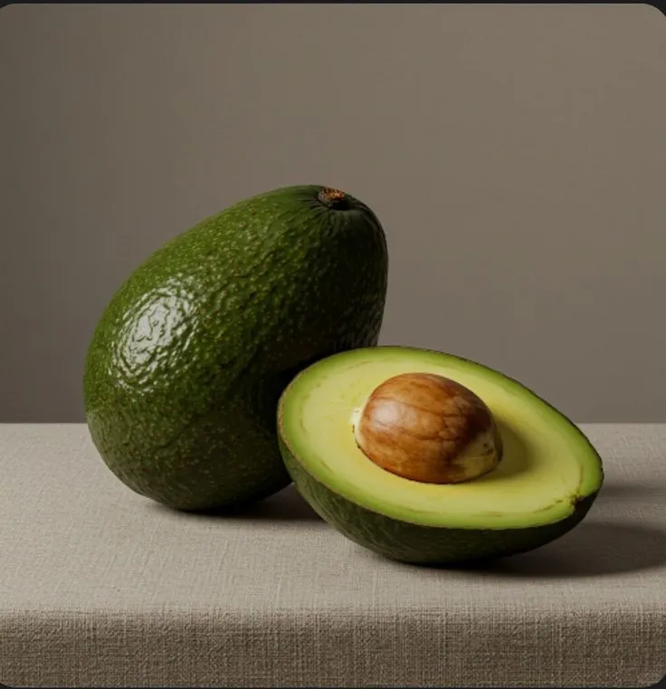
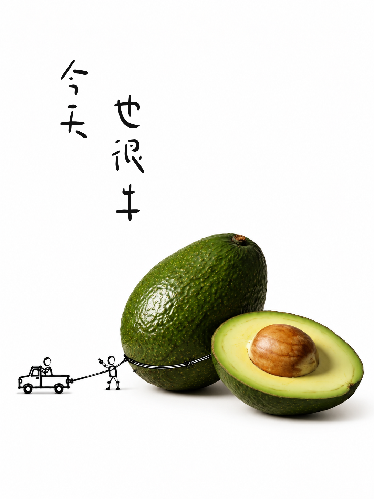
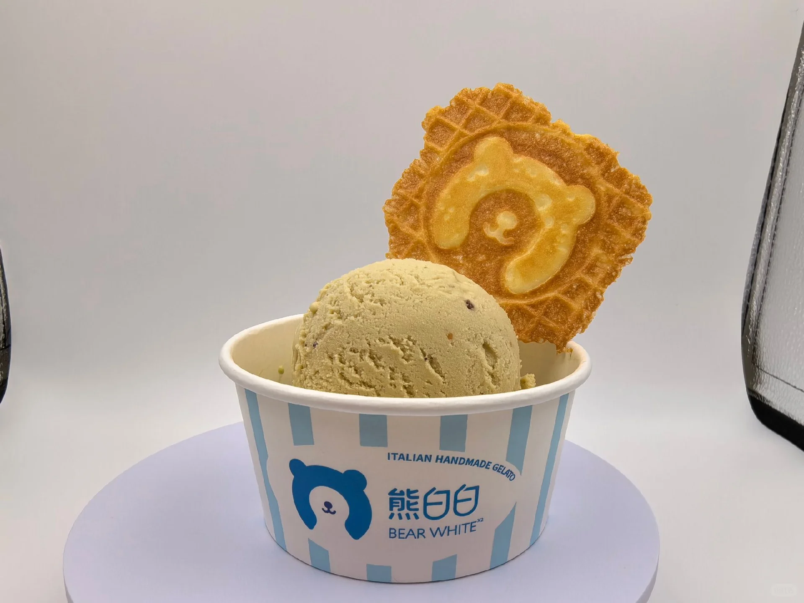
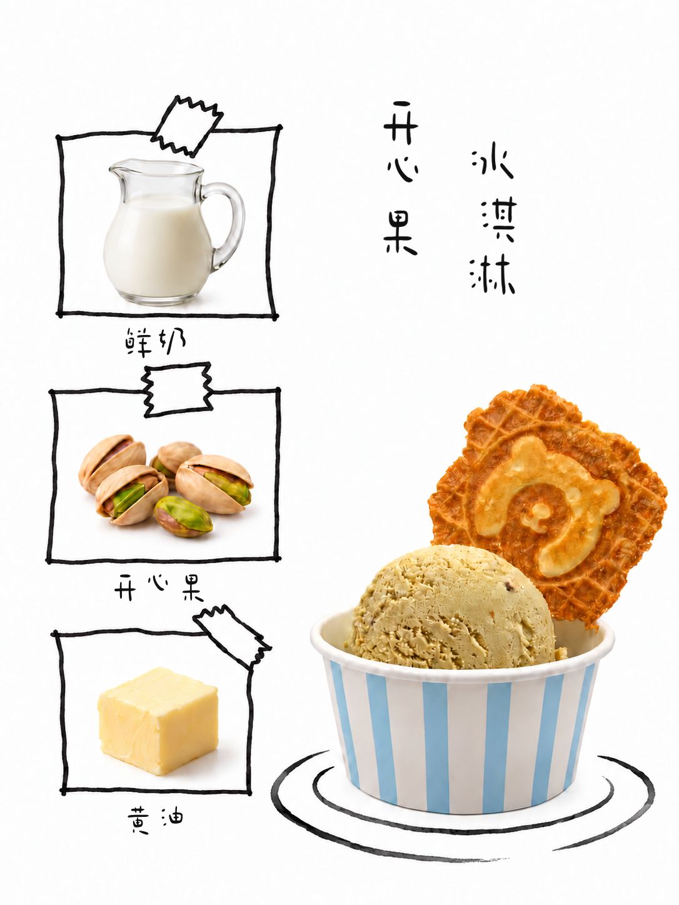
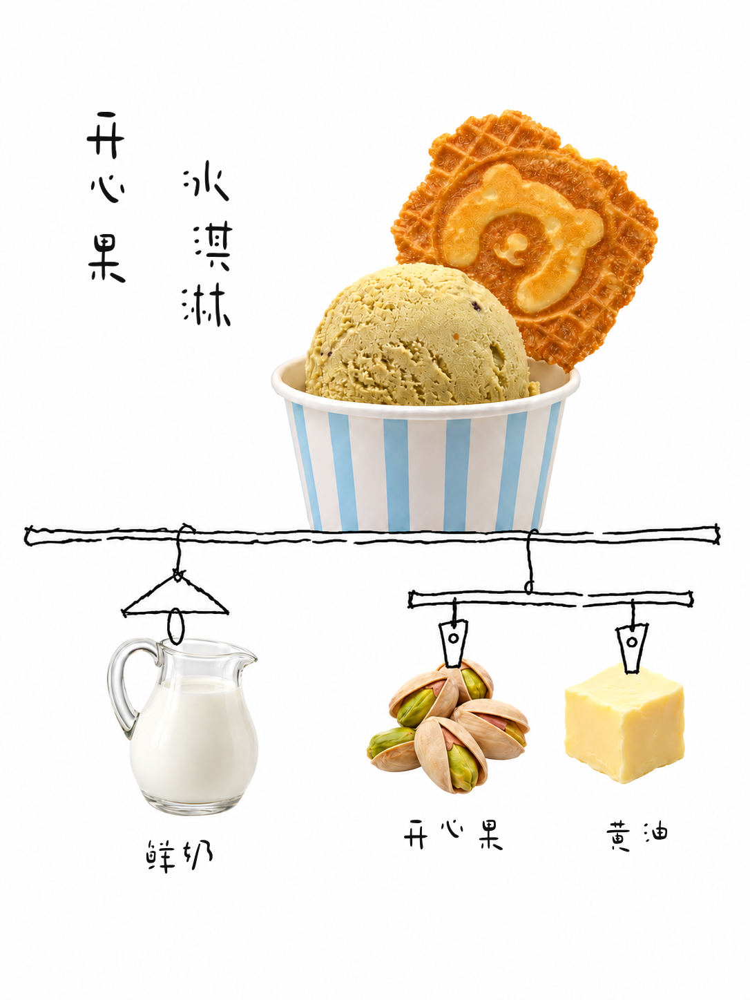

# 喜茶风海报 Skill

把用户上传的照片制作成 **3:4 极简白底海报**：保留真实摄影主体，搭配拙趣黑色手绘和真实字体标题。支持常规互动海报，以及三种固定成分展示版式。

“喜茶风”仅指留白、摄影与手绘结合的视觉语言，不代表官方出品，不复刻品牌 Logo 或吉祥物。

## 效果示例

以下按“用户上传的原图 → 海报成图”展示。常规海报成图与输入原图仅供了解效果，不自动用于后续生图；三张成分展示成图同时作为各自模板的结构参考，每次只使用所选模板对应的一张。原图指输入照片，不是无字底图。

### 常规互动海报

真实摄影主体＋微缩小人互动＋短标题。示例以小货车牵引牛油果，文案为「今天也很牛」。动作、人数与标题排版不固定。

#### 输入原图



#### 海报成图



### 三种成分展示版式

以下使用同一款开心果冰淇淋及鲜奶、开心果、黄油三种成分，方便比较版式差异；默认只生成一种，明确要求时才同时制作三种。

#### 共用输入原图

品名：开心果冰淇淋。用户提供的成分：鲜奶、开心果、黄油。下方三种版式均由这张输入照片制作。



#### 形式一：照片卡片墙 `card-wall`

左侧纵向展示三个成分卡片，右侧中下部放商品，右上放品名。卡框与托底圆弧保持自然连贯，保留手绘歪扭及笔触变化。



#### 形式二：衣架晾晒 `hanging-rack`

商品在横杆上，下方以左侧衣架、右侧双夹的结构展示三个成分；挂钩、夹子与成分之间有实际连接。



#### 形式三：主体抓取 `playful-grab`

主体在上、三个成分在下。主体表面叠加尖角三角眼、连续尖角折线嘴，并伸出手臂抓向成分；每个成分旁有两条惊惧短线。


图片使用相对路径；移动或分享 README 时，请一并保留 `docs/examples/`，不要只发送 Markdown 文件。其中三张 `ingredient-*.png` 是成分模式的结构参考，不可省略；其余图片仅用于展示原图与常规效果。已删除重复的旧参考图目录。

## 1. 使用前准备

- 可读取本地文件、执行 Python，并可调用图像生成/编辑工具的 Codex 环境。当前工作流使用内置图像生成工具；仅安装本 Skill 不会自动获得生图能力。
- Python 与 Pillow，用于把真实字体文字排到图片上。本项目已在 Python 3.12 环境使用；新环境建议使用 Python 3.10 或更新版本。
- 完整的 Skill 文件夹，尤其不能缺少 `assets/fonts/` 下的字体，以及 `docs/examples/` 中三张 `ingredient-*.png` 成分结构参考图。

检查环境，在 PowerShell 中运行：

```powershell
python --version
python -c "from PIL import Image; print('Pillow 可用')"
```

如果仅缺少 Pillow，使用对应 Python 安装：

```powershell
python -m pip install Pillow
```

若电脑使用 `py` 启动 Python，可将文中命令的 `python` 改为 `py`。字体脚本直接读取 TTF 文件，不必先安装字体到操作系统。当前内置生图路线不要求用户另行配置 API Key；字体脚本本身不负责生图，也不需要 API Key。

## 2. 安装

### 方式 A：个人安装，跨项目使用

把 `heytea-style-poster` 文件夹放到个人技能目录，确保目录层级如下：

```text
Windows：C:\Users\你的用户名\.agents\skills\heytea-style-poster\SKILL.md
macOS / Linux：~/.agents/skills/heytea-style-poster/SKILL.md
```

不要多嵌套一层同名文件夹，也不要只复制 `SKILL.md`。

以下 PowerShell 示例适用于本项目所在电脑。它复制运行所需文件、README 及 `docs/` 中精选的展示图片，不复制 `outputs/` 历史成图和临时文件；目标已存在时停止，避免覆盖已有版本。请按实际下载位置调整 `$skillSource`。

```powershell
$skillSource = 'D:\izihun\codex skill\heytea-style-poster'
$skillParent = Join-Path $env:USERPROFILE '.agents\skills'
$skillTarget = Join-Path $skillParent 'heytea-style-poster'

if (-not (Test-Path -LiteralPath (Join-Path $skillSource 'SKILL.md'))) {
    throw '找不到源 Skill，请先检查 skillSource 路径。'
}
if (Test-Path -LiteralPath $skillTarget) {
    throw '目标已存在，请先核对并备份旧版本，不要直接覆盖。'
}

New-Item -ItemType Directory -Path $skillTarget -Force | Out-Null
foreach ($skillEntry in @('SKILL.md', 'README.md', 'agents', 'references', 'scripts', 'assets', 'docs')) {
    Copy-Item -LiteralPath (Join-Path $skillSource $skillEntry) -Destination $skillTarget -Recurse
}
```

### 方式 B：只在某个项目中使用

将同一套文件放到项目内：

```text
你的项目/
└─ .agents/
   └─ skills/
      └─ heytea-style-poster/
         ├─ SKILL.md
         ├─ agents/
         ├─ references/
         ├─ scripts/
         ├─ assets/
         └─ docs/examples/
```

在该项目中使用 Codex。个人安装和项目安装通常二选一，避免同时出现同名副本。

上述安装目录和自动发现行为依据 [OpenAI 官方本地 Skill 文档](https://learn.chatgpt.com/docs/build-skills)（核对日期：2026-10-26）。Codex 通常自动检测技能变化；若未显示，重启 Codex 后再试。本机现有环境也提供了 `.codex/skills` 下的技能，但新安装按上面的官方目录操作，不要求迁移既有技能。

### 确认安装成功

在新对话中发送：

```text
请检查是否可以使用 heytea-style-poster Skill，并检查字体文件是否存在。先不生图。
```

确认能读取 Skill、字体和必要参考文件后，再上传图片开始制作。若 Skill 可以发现但没有图像生成工具，仍不能完成完整海报制作。

## 3. 怎么用

上传清晰的主体照片，再发送以下任意一种请求。直接写 Skill 名称即可；支持 `$` 技能提及的界面也可使用 `$heytea-style-poster`。

### 常规互动海报

```text
使用 heytea-style-poster，把这张照片制作成喜茶风海报。
文案你来构思，直接做一个方案。
```

也可以指定文案或动作：

```text
使用 heytea-style-poster 制作常规海报。
标题：生活加点甜。
让小人在冰淇淋旁拖运一颗配料，保留主体外形。
```

常规模式会围绕主体构思轻松、有记忆点的短文案和一个清晰互动场景。小人人数、动作、道具不固定；不会默认全部使用梯子。标题根据留白选择横排、竖排、分行或错落字块，并非固定竖排。


### 成分展示海报

```text
使用 heytea-style-poster 制作成分展示海报。
品名：开心果冰淇淋。
成分：鲜奶、开心果、黄油。
采用照片卡片墙形式。
```

三种模板可直接点名：

| 模板 | 调用名称 | 画面结构 |
| --- | --- | --- |
| 照片卡片墙 | `card-wall` / 卡片版 | 左侧三个成分卡片，右侧中下部放商品，右上放品名 |
| 衣架晾晒 | `hanging-rack` / 晾晒版 | 商品在横杆上，下方以衣架和夹子展示三个成分 |
| 主体抓取 | `playful-grab` / 抓取版 | 商品在上、三个成分在下，商品有尖角三角眼、锯齿折线嘴和抓取手臂 |

明确说“展示成分”“成分晾晒”，或为本次海报直接列出成分，都会进入成分模式。普通上传照片，或参考图里碰巧出现配料，不自动触发。

没有指定模板时，只选择一种适合主体的模板，默认不输出三张。成分超过三种时选主要或特别的三种；未提供时只依据可见、可辨认的信息判断，不凭常见配方编造隐藏成分，信息不足会询问。

成分模式用商品名称作标题，另配三个成分标签，不额外添加常规模式的广告短句。

### 

### 批量处理照片

```text
使用 heytea-style-poster，把这些照片分别制作成常规海报。
每张一个方案，整组尽量变化小人的动作、接触关系和标题排版。
```

如果不同图片的成分不同，请逐张对应列出，不要只给一份含糊的成分清单。

### 修改已有海报

附上需要修改的成图，明确需要保留与修改的部分，例如：

```text
只修改卡片边框和底部圆弧，主体、成分和文字不变。
线条保持连贯，略微歪扭，粗细与深浅自然变化，不要刻意画成虚线。
```

单次修改只应用于本次图片；想长期改变 Skill 时，请明确说“把这条写入 Skill 规则”。

## 4. 给什么信息，制作更快

最少只需提供主体照片。若有明确要求，建议一次性提供：

```text
模式：常规 / 成分展示
品名：可选；成分展示建议提供
成分：成分模式建议提供三种
模板：卡片墙 / 衣架晾晒 / 主体抓取；可留给你选
标题：可选，未指定时由AI构思
必须保留：主体颜色、包装、角度等
希望去掉：背景、杂物、原有文字等
输出位置：可选
```

建议上传主体完整、遮挡少、清晰度足够的原图。如果是拼图或教程截图，可直接说明“只提取左上角成品”。默认直接确定一个方案，不需要先来回选择多个提案。

## 5. 生成过程与交付

1. 识别主体、选择模式，确定文案或品名与成分。
2. 调用图像工具制作无新增文字的白底底图，保留摄影质感并完成简笔画结构。
3. 使用本地真实字体程序化排字，输出带字成图。
4. 检查文字、对应关系、留白和线稿连接，只修正失败部分。

默认交付 3:4 带字图片；具体像素尺寸以实际成图为准，不固定为某个分辨率。底图与排版 JSON 是中间文件，最终图片是主要交付物。可要求保存到指定目录；随包展示示例位于 `docs/examples/`。`outputs/` 是可按需创建的输出目录，不需要预先存在。

主体由图像模型编辑，可能出现局部细节变化，不承诺像素级无损抠图。若包装或结构必须精确保留，请事先指出。

## 6. 文件结构与高级使用

```text
heytea-style-poster/
├─ SKILL.md                         模式入口与执行规则
├─ README.md                        安装及使用说明
├─ docs/examples/                   README 展示图；三张成分成图兼作结构参考
├─ agents/openai.yaml               技能显示名称等元信息
├─ references/
│  ├─ poster-base.md                 常规主体、动作与线稿规则
│  ├─ typography.md                  文案、真实字体排版规则
│  └─ ingredient-display.md          三种固定成分模板
├─ assets/fonts/                    字体文件与授权提示
└─ scripts/render_real_font.py       真实字体合成工具
```

如需调整字体、文案或模板规则，修改对应文件，而不是依赖旧对话记忆。常规模式不自动回看历史正例；成分模式根据所选模板，仅使用 `docs/examples/` 中对应的一张成分成图作为结构参考，不沿用其中的商品身份或文字。字体有变动时，需同步修改字体路径及相关规则。

### 手动运行排字脚本

普通用户无需手动运行，Codex 会负责。以下用于调试：先准备已生成的底图 `background.png`，再保存 UTF-8 编码的 `typography.json`：

```json
{
  "blocks": [
    {
      "text": "生活加点甜",
      "x": 0.12,
      "y": 0.10,
      "font_size": 0.075,
      "color": "#111111",
      "tracking": 0.003
    }
  ]
}
```

在 Skill 文件夹中运行（PowerShell 单行命令）：

```powershell
python .\scripts\render_real_font.py --input .\background.png --font '.\assets\fonts\字魂漫涂随写体(商用需授权).ttf' --spec .\typography.json --output .\outputs\poster.png
```

`x`、`y` 为归一化画布坐标，`font_size` 相对画布高度，`tracking` 相对画布宽度。常规模式接受 1–3 个文本块，每块最多 10 个非换行字符；成分模式需在命令末尾添加 `--mode ingredient-display`，并提供恰好四个文本块：一个品名、三个标签。详细排版字段见 [typography.md](references/typography.md)。

该脚本仅排字：不会生成底图、自动抠图、自动分析成分或自动适配所有版式。

## 7. 常见问题

- **找不到 Skill**：确认目录内直接存在 `SKILL.md`，检查是否多嵌套了一层；用完整名称显式调用，必要时重启 Codex。也可让 Codex 直接读取本地 `SKILL.md` 路径进行排查。
- **只有提示词，没有成图**：检查当前环境是否提供可用的图像生成/编辑工具。Skill 是工作流，不是独立生图模型。
- **提示 `No module named PIL`**：使用运行脚本的同一个 Python 执行 `python -m pip install Pillow`。
- **提示找不到字体或输入文件**：确认完整复制了 `assets/`，并核对命令当前目录与路径。可以改为绝对路径。
- **文字不在正确位置**：调整排版 JSON 后重新运行排字脚本；底图没有问题时无需重新生图。
- **为什么没有同时生成三种成分版式**：默认每次一个方案；需要三种时明确说“同时制作三种形式”。

## 8. 授权与分享

当前字体为 `字魂漫涂随写体(商用需授权).ttf`。随附文件不等于授予商业使用或再分发权限；商业发布、字体转交或公开打包前，请单独确认相应授权。

参考图仅用于视觉与结构参考，不代表取得原图片、品牌资产的商用或再分发许可。分享 Skill 前应检查字体和参考图授权，必要时用自有或已授权资源替换，并同步修改引用路径。当前分享目录已清除未引用的小人旧正例、临时验证文件和 Python 缓存，保留运行资源与 `docs/examples/` 展示图；后续新产生的 `outputs/`、`tmp/` 和 `__pycache__/` 不需要作为运行依赖一并分享。

本 README 只提供安装及使用步骤，不会自行安装 Skill、下载依赖或改变现有设计规则。
